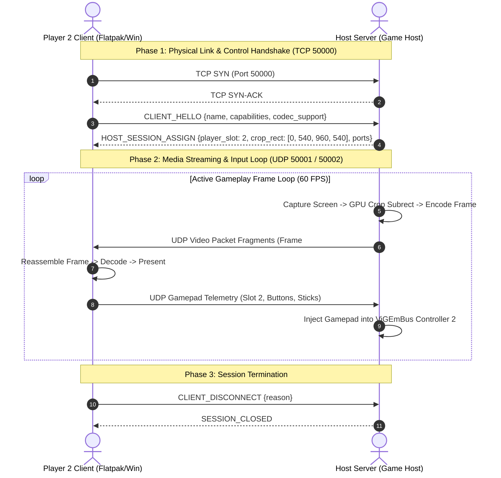

# SplitScreenP2P: System Architecture and Protocol Design Report

**Course:** Network Application Design  
**Project:** SplitScreenP2P (Off-Grid Split-Screen Desktop Streaming & Input Forwarding)  
**Authors:** [Author 1], [Author 2], [Author 3], [Author 4]  
**Date:** November 2026  

---

## 1. Project Background, Motivation, and Purpose

### 1.1 Problem Context
Split-screen multiplayer gaming has provided decades of memorable cooperative and competitive gaming. However, modern multi-monitor and mobile PC hardware configurations highlight two major obstacles in conventional local split-screen:
1. **Screen Cheating / Peeking:** In tactical or competitive local multiplayer titles (first-person shooters, racing games, stealth games), each player shares the same screen space. This allows opponents to observe competitor coordinates, health, ammunition, and ambush routes.
2. **Infrastructure Dependency in Off-Grid Environments:** Gamers traveling, in academic dorms, or at outdoor LAN sessions often lack reliable Wi-Fi routers or high-speed internet.

Conventional game streaming systems (e.g., Steam Remote Play, Moonlight, Parsec) assume an established local area network (LAN) connected via an external router and broadcast the *entire* screen surface. This causes severe bandwidth waste and fails to prevent screen peeking.

### 1.2 Purpose and Objectives
**SplitScreenP2P** provides a decentralized, router-free peer-to-peer system that:
- Captures and splits the host display canvas in real-time.
- Streams only the assigned viewport slice (e.g., player quadrant) to each client.
- Operates directly over ad-hoc wireless connections (Wi-Fi Direct / SoftAP) without external network infrastructure.
- Forwards client physical gamepad inputs back to the host machine, injecting them as independent virtual controllers.

---

## 2. Design Decisions and Trade-offs

| Design Decision | Alternative Considered | Chosen Approach | Rationale |
| :--- | :--- | :--- | :--- |
| **Transport Model** | Pure TCP | **Hybrid (TCP Control + UDP Media & Input)** | TCP retransmission mechanisms create head-of-line blocking fatal to interactive gaming; UDP guarantees that delayed frames/inputs are dropped in favor of current state. |
| **Media Framing** | WebRTC / RTSP | **Custom Low-Overhead UDP Framing** | WebRTC introduces ICE/STUN/TURN signaling bloat unneeded in direct 1-hop Wi-Fi P2P. A tailored 16-byte binary header provides minimal packet overhead ($\le 1.1\%$). |
| **P2P Topology** | Wi-Fi P2P Group Owner | **SoftAP / Hosted Direct Link** | Raw Wi-Fi Direct API implementations differ substantially across Windows and Linux. Direct SoftAP with link-local IP assignment ensures 100% cross-platform compatibility between Windows and Linux Flatpaks. |
| **Screen Partitioning** | Client-Side Cropping | **Server-Side GPU Cropping** | Server-side cropping eliminates wasted bandwidth by transmitting only $25\%$ of pixels in a 4-player split, reducing encoder load and transmission latency. |
| **Input Injection** | Keystroke Hooking | **Virtual Bus Emulation (ViGEmBus / uinput)** | Virtual gamepads appear to the OS as authentic hardware XInput/DirectInput controllers, enabling native multi-controller support in games. |

---

## 3. Communication Model & Protocol Specification

### 3.1 Network Architecture Topology
The system operates as a Star P2P topology centered on the host:
- **Control Plane:** Persistent TCP connection on Port `50000`.
- **Data Plane:** Bidirectional UDP sockets on Ports `50001` (Downstream Video) and `50002` (Upstream Input).



### 3.2 Message Formats

#### 3.2.1 TCP Control Plane Messages (Length-Prefixed JSON)
Every TCP message is preceded by a 32-bit big-endian integer denoting payload length in bytes.

```
+-----------------------------+---------------------------------------+
|  Length (4 Bytes, Big Endian)|         JSON Payload (N Bytes)        |
+-----------------------------+---------------------------------------+
```

##### Message Schema: `CLIENT_HELLO`
```json
{
  "type": "CLIENT_HELLO",
  "client_version": "1.0.0",
  "client_name": "Deck-Linux",
  "preferred_codec": ["H264", "VP8", "JPEG"],
  "display_caps": {
    "native_width": 1280,
    "native_height": 800,
    "refresh_rate": 60
  },
  "controller_type": "XINPUT_GAMEPAD"
}
```

##### Message Schema: `HOST_SESSION_ASSIGN`
```json
{
  "type": "HOST_SESSION_ASSIGN",
  "session_id": "sess_81a2f0",
  "player_slot": 2,
  "assigned_crop": {
    "source_x": 0,
    "source_y": 540,
    "source_w": 960,
    "source_h": 540,
    "target_fps": 60,
    "target_bitrate_kbps": 4000,
    "selected_codec": "H264"
  },
  "udp_stream_port": 50001,
  "udp_input_port": 50002
}
```

---

#### 3.2.2 UDP Video Streaming Datagram Protocol (Downstream)
Each video frame is sliced into MTU-safe chunks ($< 1400$ bytes) with a fixed 16-byte header:

```
 0                   1                   2                   3
 0 1 2 3 4 5 6 7 8 9 0 1 2 3 4 5 6 7 8 9 0 1 2 3 4 5 6 7 8 9 0 1
+-+-+-+-+-+-+-+-+-+-+-+-+-+-+-+-+-+-+-+-+-+-+-+-+-+-+-+-+-+-+-+-+
|       Magic ID (0x5350)       |    Slot ID    |     Flags     |
+-+-+-+-+-+-+-+-+-+-+-+-+-+-+-+-+-+-+-+-+-+-+-+-+-+-+-+-+-+-+-+-+
|                          Frame ID                             |
+-+-+-+-+-+-+-+-+-+-+-+-+-+-+-+-+-+-+-+-+-+-+-+-+-+-+-+-+-+-+-+-+
|         Packet Index          |         Packet Count          |
+-+-+-+-+-+-+-+-+-+-+-+-+-+-+-+-+-+-+-+-+-+-+-+-+-+-+-+-+-+-+-+-+
|                         Timestamp (us)                        |
+-+-+-+-+-+-+-+-+-+-+-+-+-+-+-+-+-+-+-+-+-+-+-+-+-+-+-+-+-+-+-+-+
|                     Video Payload (MTU Bytes)                 |
|                              ...                              |
+-+-+-+-+-+-+-+-+-+-+-+-+-+-+-+-+-+-+-+-+-+-+-+-+-+-+-+-+-+-+-+-+
```

* **Flags Field Definition:**
  * Bit 0: `IS_KEYFRAME` (1 if I-frame/Intra, 0 if P-frame/Inter)
  * Bit 1: `IS_LAST_PACKET` (1 if this chunk completes the frame)
  * Bit 2-7: Reserved

---

#### 3.2.3 UDP Peripheral Input Datagram Protocol (Upstream)
Clients sample physical controllers at 120–250 Hz and stream a 24-byte packet:

```
 0                   1                   2                   3
 0 1 2 3 4 5 6 7 8 9 0 1 2 3 4 5 6 7 8 9 0 1 2 3 4 5 6 7 8 9 0 1
+-+-+-+-+-+-+-+-+-+-+-+-+-+-+-+-+-+-+-+-+-+-+-+-+-+-+-+-+-+-+-+-+
|       Magic ID (0x4750)       |    Slot ID    |  Packet Seq   |
+-+-+-+-+-+-+-+-+-+-+-+-+-+-+-+-+-+-+-+-+-+-+-+-+-+-+-+-+-+-+-+-+
|         Buttons Mask          | Left Trigger  | Right Trigger |
+-+-+-+-+-+-+-+-+-+-+-+-+-+-+-+-+-+-+-+-+-+-+-+-+-+-+-+-+-+-+-+-+
|        Thumbstick LX          |        Thumbstick LY          |
+-+-+-+-+-+-+-+-+-+-+-+-+-+-+-+-+-+-+-+-+-+-+-+-+-+-+-+-+-+-+-+-+
|        Thumbstick RX          |        Thumbstick RY          |
+-+-+-+-+-+-+-+-+-+-+-+-+-+-+-+-+-+-+-+-+-+-+-+-+-+-+-+-+-+-+-+-+
|                     Client Timestamp (High 32)                |
+-+-+-+-+-+-+-+-+-+-+-+-+-+-+-+-+-+-+-+-+-+-+-+-+-+-+-+-+-+-+-+-+
|                     Client Timestamp (Low 32)                 |
+-+-+-+-+-+-+-+-+-+-+-+-+-+-+-+-+-+-+-+-+-+-+-+-+-+-+-+-+-+-+-+-+
```

---

## 4. Platform Implementation and Packaging Notes

### 4.1 Target Platforms
- **Windows Host & Client:** Single binary `.exe` built with native DXGI screen capture and ViGEmBus client driver.
- **Linux Client:** Packaged as an isolated Flatpak with Wayland/X11 surface rendering, PipeWire support, and `/dev/uinput` permissions.

### 4.2 Wi-Fi Direct & Off-Grid Topology
When no router is present, the host initializes an ad-hoc SoftAP network via OS native APIs. The clients discover or connect directly to the host's direct P2P radio. Standard DHCP or Link-Local IP allocation assigns addresses within the subnetwork.

### 4.3 Performance & Latency Budgets
- Capture + GPU Crop: $\approx 2\text{--}4\text{ ms}$
- Hardware Encode (NVENC/VAAPI): $\approx 4\text{--}6\text{ ms}$
- UDP P2P Wireless Transit: $\approx 2\text{--}5\text{ ms}$
- Client Reassembly + Decode + Present: $\approx 4\text{--}8\text{ ms}$
- **Target Glass-to-Glass Latency:** $\le 25\text{ ms}$
